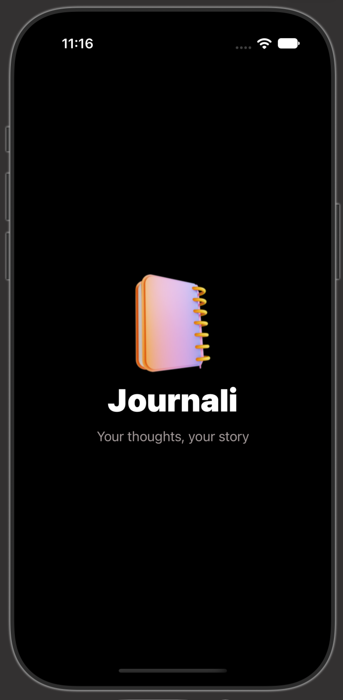
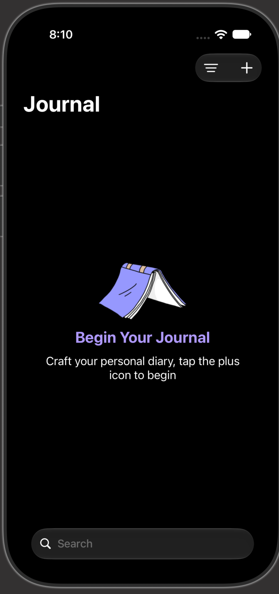
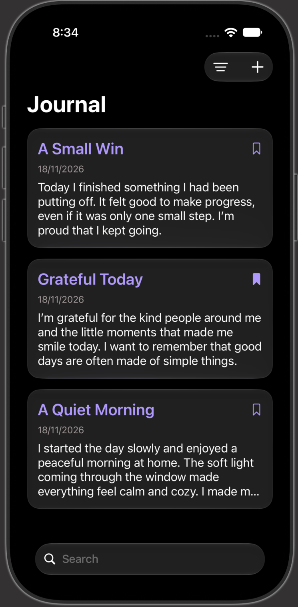
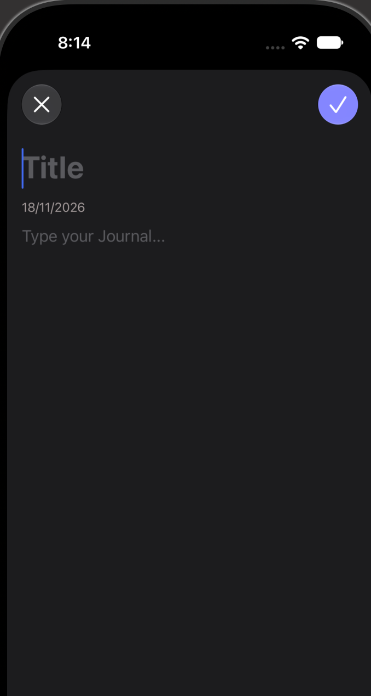
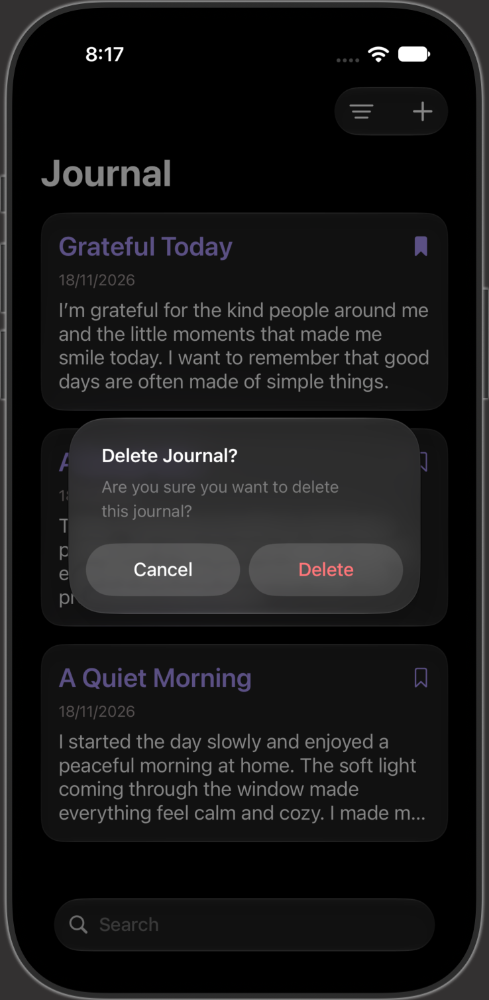

# Journali

A little place on my iPhone where I write down my day.

I built Journali during the Swift and SwiftUI challenge at the Apple Developer Academy in Riyadh. The idea is simple: open the app, write, and keep what matters.

## What it does

- Opens with a short splash, then shows an empty page that tells you to start writing
- Lets you add a journal with a title and a text, and the date is saved for you
- Lets you tap a card to change what you wrote
- Lets you bookmark a card, and tap again to remove the bookmark
- Lets you swipe a card to delete it, but asks you first
- Asks "Discard changes?" if you close the page after typing
- Finds entries while you type in the search bar
- Sorts entries by bookmark or by date

## How I built it

- **Swift and SwiftUI** for the screens
- **MVVM**: the Model holds the data, the ViewModel makes the decisions, and the Views only show things
- **An enum** for the two sort choices, so I cannot mistype them
- **Optionals** to remember which card is being edited or deleted
- **Dark mode** set once for the whole app, so the system handles the colors
- **Liquid Glass** on the cards, the buttons, and the search bar
- **Colors saved in Assets** instead of repeating the same numbers in the code

## Screenshots

| Splash | Empty page | My journals |
|---|---|---|
|  |  |  |

| New journal | Delete |
|---|---|
|  |  |

## Something I learned

I used to think the screen should change the data itself. In this project I learned that the screen only asks, and the ViewModel does the work.

— Renad
